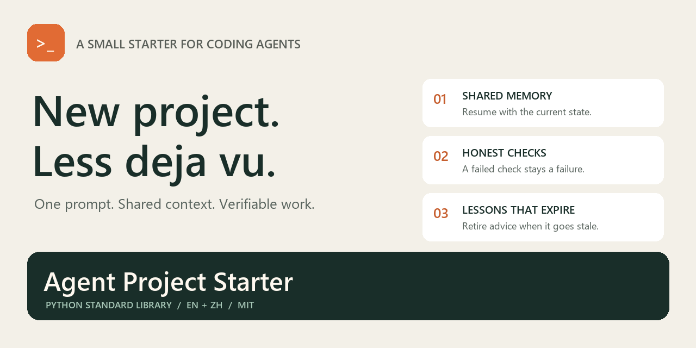
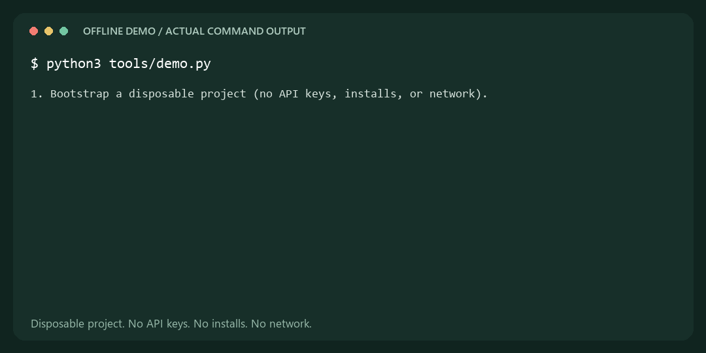
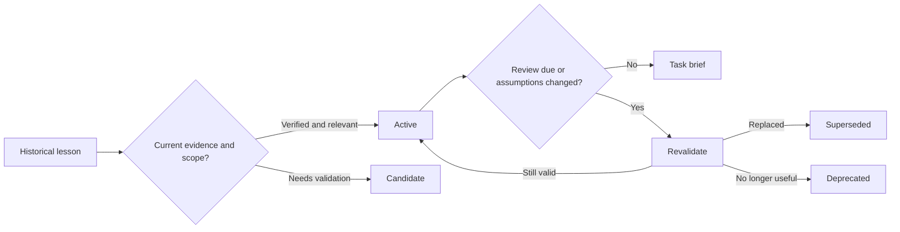

<p align="center">
  
</p>

<h1 align="center">Agent Project Starter</h1>

<p align="center"><strong>Give your coding agent a clean start. Keep the useful lessons. Retire the stale ones.</strong></p>

<p align="center">
  <a href="https://github.com/yuanzd123/agent-project-starter/actions/workflows/ci.yml"></a>
  <a href="LICENSE"></a>
  
  
</p>

<p align="center"><strong>English</strong> · <a href="README.zh-CN.md">简体中文</a></p>

A **standalone bootstrap prompt** and a small local toolkit for coding agents: shared project memory, checks that cannot silently pass, and lessons with scope and review dates. Designed around plain Markdown and JSON so you can inspect, edit, and move it between tools.

**Start with the [English prompt](BOOTSTRAP_PROMPT.md) or [中文 Prompt](BOOTSTRAP_PROMPT.zh-CN.md).** Copy it into your agent, describe your project, and let the agent adapt the setup to the code you actually have.

## Why this exists

A fresh agent session can repeat yesterday's mistake. A growing memory folder can preserve yesterday's workaround long after it stops applying. A wrapper can even report success after a test fails.

This starter connects three small pieces:

| Problem | Mechanism |
| --- | --- |
| Sessions lose the current state | One shared memory entry, a current snapshot, and durable decisions |
| Old advice keeps returning | Scoped lessons with active, candidate, deprecated, and superseded states |
| Context grows without limit | Task-tag retrieval: up to five lessons and 4,500 characters by default |
| Checks look green without proving anything | Explicit required checks; missing configuration and failures exit nonzero |
| Installing a template overwrites work | Preview first, conflict detection, no force-overwrite mode |

This is a starter you own. No account, API key, telemetry, vector database, or third-party Python runtime package is required by the toolkit. Your chosen agent and project commands have their own requirements.

## Try it

### Option A: just the prompt

Open [BOOTSTRAP_PROMPT.md](BOOTSTRAP_PROMPT.md), copy the text between the separators, fill in the project goal, and send it to your agent. It works without cloning this repository.

The prompt tells the agent to inspect the existing project, reuse its conventions, create working files, verify the setup, and explain which old lessons were kept or retired.

### Option B: run the toolkit

Requires Python 3.10+ and Git for cloning.

```sh
git clone https://github.com/yuanzd123/agent-project-starter.git
cd agent-project-starter
python3 tools/demo.py
```

The demo runs real commands in a temporary directory, exercises intentional failures, and removes its disposable project. It does not touch your project or call external services.

<p align="center">
  
</p>

Preview an installation, then apply it to a new project:

```sh
python3 tools/bootstrap.py ../my-project
python3 tools/bootstrap.py ../my-project --apply
```

For Chinese project memory, add `--lang zh-CN`. Runtime code is shared across languages.

```sh
cd ../my-project
python3 scripts/memory.py brief --task "database testing"
python3 scripts/memory.py check
python3 harness/run.py list
```

**Next:** ask your agent to adapt `AGENTS.md`, `LATEST.md`, and `harness/config.json` to your actual project using the bootstrap prompt. Then run `python3 harness/run.py check`.

An untouched scaffold deliberately returns **NOT_CONFIGURED** for application checks. It never claims that an empty application has passed.

On Windows, use `python` if that is your installed command. For WSL projects, run the Linux toolchain inside WSL. [Configuration and command boundaries →](template/docs/workflows/project-workflow.md)

### Already have a project?

The installer refuses conflicting files before writing. Generate into an empty staging directory and have your agent merge the diff into existing instructions and memory. Identical re-runs are no-ops; changed project files are preserved. There is no automatic upgrade or destructive reset.

## What gets created

```text
AGENTS.md                   Project instructions and reading order
CLAUDE.md                   One-line import of AGENTS.md
harness/
  config.json               Explicit projects and required checks
  run.py                    list / check / lint / typecheck / test / build
scripts/memory.py           check / index / brief
docs/memory/
  MEMORY.md                 Short shared entry
  LATEST.md                 Current state, not a growing conversation log
  DECISIONS.md              Decisions and reconsideration conditions
  lessons.json              Lifecycle metadata
  LESSONS_INDEX.md          Generated navigation
  IMPORT_REVIEW.md          What was kept, deferred, or retired
  lessons/                  One lesson per file
docs/workflows/              Project workflow
```

[Read the memory guide](docs/MEMORY_GUIDE.md) · [Understand the architecture](docs/ARCHITECTURE.md) · [See configuration examples](docs/EXAMPLES.md)

## Memory that can retire advice



A review date is a reason to check a lesson, not proof it is false. Due lessons leave the default brief and make memory validation report **NEEDS_REVIEW**. The tool never silently refreshes their dates or destroys their history.

The starter includes **16 distilled principles**, **3 candidate categories**, and **2 retirement records**. Examples cover failure propagation, persistent writes, draft preservation, actual rendering paths, time-zone tests, and task-owned Git changes. [Browse the lessons →](template/docs/memory/LESSONS_INDEX.md)

These are scoped engineering principles, not a claim that every workaround has been verified in your stack.

## Agent compatibility

- **Codex:** uses the project `AGENTS.md` entry.
- **Claude Code:** the template includes `CLAUDE.md` with `@AGENTS.md`, keeping one rules source across sessions that use different loading modes.
- **Other coding agents:** give them the standalone prompt and explicitly point to the entry files. No untested native plugin integration is claimed.

Confirm the instructions your actual agent loaded after setup. See the [official Codex guidance](https://learn.chatgpt.com/docs/agent-configuration/agents-md) and [Claude memory documentation](https://code.claude.com/docs/en/memory) for current loading behavior.

## Trust and limits

The harness is **not an OS sandbox**. Commands inherit your environment and may load their own credentials or hooks. Review the actual commands and resource identities before running them. Timeouts control the direct child; detached workers need their own cleanup.

Memory validation checks structure, links, size budgets, and review metadata. It cannot establish truth, provide semantic search, or detect every secret. Retrieval uses explicit tags. See [SECURITY.md](SECURITY.md).

## Contribute

A small, reproducible improvement is useful: a regression test, translation correction, configuration example, or lesson with evidence and an expiry condition.

```sh
python3 -m unittest discover -s tests -v
python3 tools/check_locales.py
python3 tools/check_docs.py
```

[Contribution guide](CONTRIBUTING.md) · [Good first issues](https://github.com/yuanzd123/agent-project-starter/issues?q=is%3Aissue+is%3Aopen+label%3A%22good+first+issue%22) · [Report a bug](https://github.com/yuanzd123/agent-project-starter/issues/new/choose) · [Changelog](CHANGELOG.md)

If this helps you start or resume a real project, a star helps other developers discover it. Even better: share a sanitized failure case that can become a tested lesson.

## Related projects

[Spec Kit](https://github.com/github/spec-kit), [Superpowers](https://github.com/obra/superpowers), and [Context Engineering Intro](https://github.com/coleam00/context-engineering-intro) offer broader or different approaches to agent workflows. This project focuses on a portable starting prompt, a local verification entry, and a small memory lifecycle. No affiliation or endorsement is implied.

## License

[MIT](LICENSE). Starter-derived files retain [their license notice](template/STARTER_LICENSE.txt); your application's licensing remains your decision.
